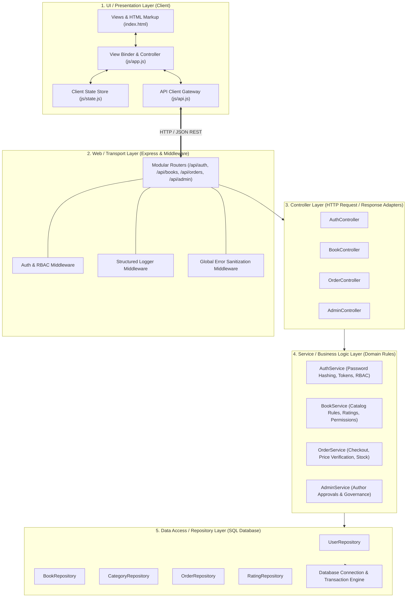

# 📚 BookWorm — Enterprise Scalable Layered Bookstore

A responsive, enterprise-grade eCommerce Bookstore built with **Node.js, Express, Relational SQLite, and Decoupled Presentation Architecture**, engineered leveraging **IBM BOB Agentic Workflows**.

---

## 🏛️ Scalable Layered Architecture

The application is structured into decoupled layers, separating presentation, transport, business rules, and data access:



---

## 📁 Directory Structure & Layer Responsibilities

```
IBM_BOB_BookWorm_Demo/
├── public/                          # 🎨 LAYER 1: UI / PRESENTATION LAYER
│   ├── index.html                   # HTML5 Semantic Document Structure
│   ├── style.css                    # Design System & Responsive Tokens
│   └── js/
│       ├── api.js                   # API Client Gateway (fetch abstraction)
│       ├── state.js                 # Reactive State Store (User, Cart, Catalog)
│       └── app.js                   # Presentation Controller & DOM Binder
│
├── src/
│   ├── config/                      # ⚙️ CONFIGURATION LAYER
│   │   ├── env.js                   # Environment & Host (127.0.0.1)
│   │   └── constants.js             # Roles, User Statuses, Order Statuses
│   │
│   ├── middleware/                  # 🛡️ MIDDLEWARE LAYER
│   │   ├── auth.middleware.js       # JWT & Role RBAC Guard
│   │   ├── logger.middleware.js     # Structured Request Logger
│   │   └── error.middleware.js      # Central Sanitized Error Handler
│   │
│   ├── routes/                      # 🌐 LAYER 2: HTTP ROUTER TRANSPORT
│   │   ├── auth.routes.js
│   │   ├── book.routes.js
│   │   ├── category.routes.js
│   │   ├── order.routes.js
│   │   ├── admin.routes.js
│   │   └── index.js
│   │
│   ├── controllers/                 # 🎮 LAYER 3: CONTROLLER LAYER
│   │   ├── auth.controller.js
│   │   ├── book.controller.js
│   │   ├── category.controller.js
│   │   ├── order.controller.js
│   │   └── admin.controller.js
│   │
│   ├── services/                    # 💼 LAYER 4: BUSINESS SERVICE LAYER
│   │   ├── auth.service.js
│   │   ├── book.service.js
│   │   ├── order.service.js
│   │   ├── admin.service.js
│   │   └── category.service.js
│   │
│   ├── repositories/                # 🗄️ LAYER 5: DATA ACCESS / REPOSITORY LAYER
│   │   ├── user.repository.js       # Parameterized SQL for Users & Roles
│   │   ├── book.repository.js       # Parameterized SQL for Books & Inventory
│   │   ├── category.repository.js   # Parameterized SQL for Categories
│   │   ├── order.repository.js      # Parameterized SQL for Orders
│   │   └── rating.repository.js     # Parameterized SQL for Book Ratings
│   │
│   ├── database/                    # 💾 DATABASE INFRASTRUCTURE
│   │   ├── connection.js            # SQLite Connection Engine
│   │   ├── schema.js                # Table DDL Definitions
│   │   └── seed.js                  # Initial Database Seeder
│   │
│   └── server.js                    # 🚀 Server Assembly & Bootstrap
│
├── test/                            # 🧪 AUTOMATED TESTS
│   └── verify.js                    # 3-Role System End-to-End Test Suite
└── package.json
```

---

## 👥 3 Core Roles & Permission Model

| Role | User & Credentials | Status / Approval | Allowed Actions & Permissions |
| :--- | :--- | :--- | :--- |
| **👑 Super Admin** | **Sumit Dobriyal**<br>`dobriyal.sumit@gmail.com`<br>*(Pass: `SuperAdmin@123`)* | Fixed / Read-only *(Excluded from public signup)* | • Review author applications<br>• Approve, reject, or remove authors<br>• Add verified authors manually<br>• Full platform & repository power |
| **✍️ Book Author** | **Sam Newman** *(Approved)*<br>`sam.newman@bookworm.io`<br>*(Pass: `Author@123`)*<br><br>**Jane Austen** *(Pending)*<br>`jane.austen@bookworm.io` | Starts as `PENDING` upon registration, becomes `APPROVED` when Super Admin approves | • Publish new books (`POST /api/books`)<br>• Edit book information (`PUT /api/books/:id`)<br>• Delete authored books (`DELETE /api/books/:id`)<br>*(Active only once approved by Super Admin)* |
| **🛍️ General Customer** | **John Doe**<br>`john.doe@example.com`<br>*(Pass: `User@123`)* | `APPROVED` immediately upon registration | • Browse book repository & search<br>• Add items to cart & proceed to checkout<br>• Rate book content (1–5 stars)<br>• *Restricted from author/admin actions (403)* |

---

## 🚀 Quick Start Guide

### 1. Install Dependencies
```bash
npm install
```

### 2. Seed SQLite Database
```bash
npm run seed
```

### 3. Start the Express Server
```bash
npm start
```
The application will start at: **`http://127.0.0.1:3000`**

### 4. Run Automated Test Suite
```bash
npm test
```
